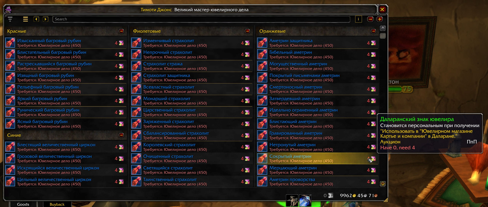
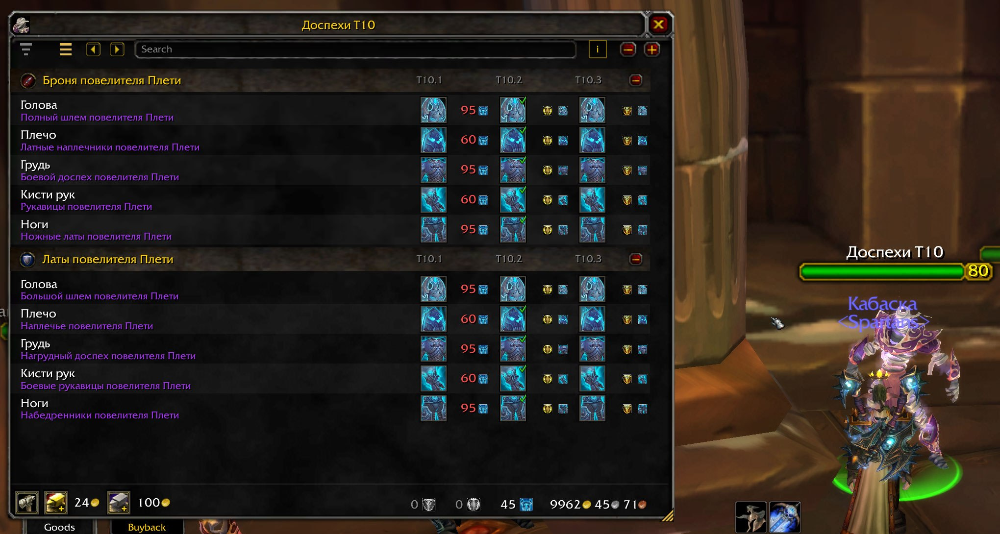
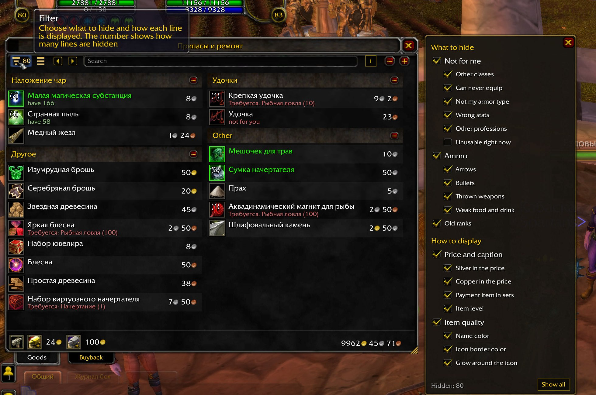
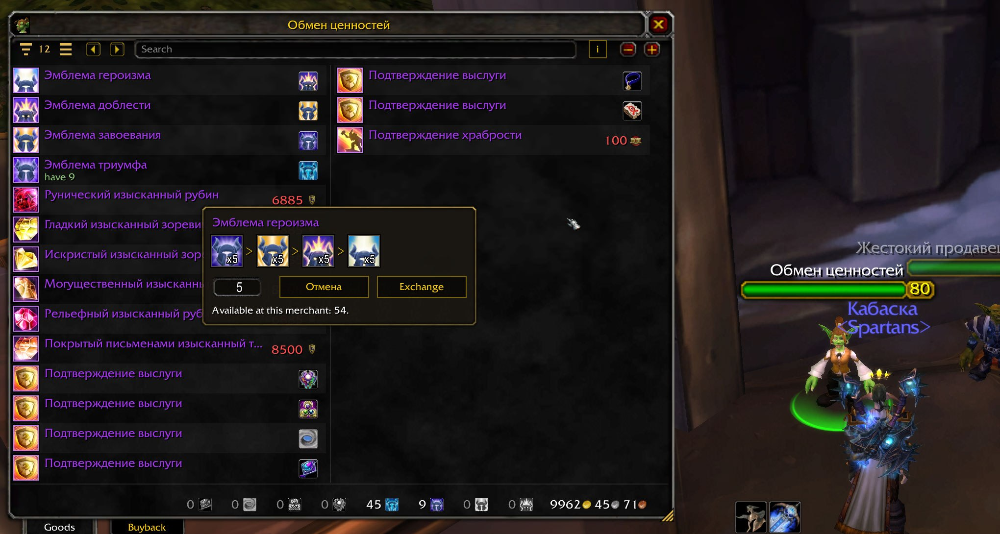
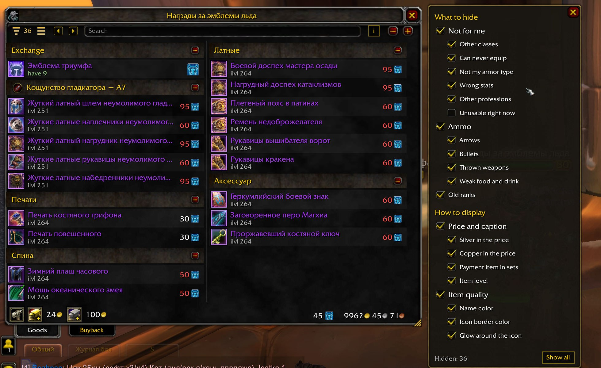
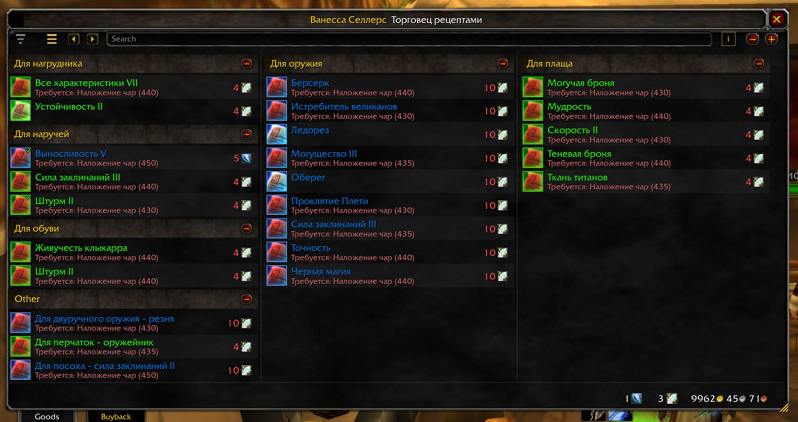

# ManaCode Vendor 1.0.1

Весь товар торговца в одном окне для WoW 3.3.5a · The entire merchant stock in one window for WoW 3.3.5a.

[Русский](#русский) · [English](#english) · [Скачать / Download](https://github.com/dmitriinosach/-MANACODE-Vendor/releases/latest)

## Скриншоты · Screenshots

*Весь товар ювелира одним списком в три колонки, группы по цвету камня · The whole jewelcrafter stock as one list in three columns, grouped by gem color*

*Набор T10: слоты строками, ступени T10.1–T10.3 рядом, галочки у того, что уже есть · Tier 10 set: slots as rows, T10.1–T10.3 side by side, check marks on what you already own*

*Панель фильтра: что спрятать и как показывать, число спрятанных строк у значка · Filter panel: what to hide and how to show, hidden line count on the icon*

*Обмен эмблем: цепочка до нужной валюты и покупка пачкой · Emblem exchange: the chain down to the currency you need, bought in bulk*

*Награды за эмблемы: сезон арены с меткой, печати и плащи группами, фильтр рядом · Emblem rewards: an arena season with its mark, sigils and cloaks grouped, filter panel beside*

*Рецепты наложения чар по слотам, цена в знаках ювелира · Enchanting recipes grouped by slot, priced in jewelcrafter tokens*

## Русский

**[MANACODE] Vendor — весь товар торговца в одном окне для WoW 3.3.5a.**

Делюсь очередной своей наработкой. Сделал аддон, чтобы не листать страницы
у торговцев и быстрее находить нужную вещь. Им уже пользуется небольшое число
игроков. Если людям зайдёт, буду дорабатывать дальше — по своим задачам
и вашим отзывам.

Вместо страниц по десять предметов Vendor показывает весь ассортимент
прокручиваемым списком. Окно открывается само при разговоре с торговцем.

**Что полезного**

- Наборы экипировки собраны вместе: слоты строками, ступени улучшений рядом,
  короткие метки тиров и сезонов арены.
- Остальной товар группируется по типу, профессии или рангу репутации.
  Есть поиск по имени; на русском клиенте он понимает и неверную раскладку.
- Фильтры скрывают ненужное: чужой класс, неподходящую броню и характеристики,
  реагенты чужих профессий, устаревшие ранги, слабую еду и питьё.
- Видно, какие вещи уже есть в сумках или на персонаже; сколько лежит
  в банке, написано в подсказке.
- Подсказка «Для чего» объясняет, какому заклинанию или рецепту нужен реагент,
  и учитывает записанные профессии других персонажей. После установки откройте
  окно профессии, чтобы аддон запомнил рецепты.
- Покупка пачками x5, x20 и x100 или своим количеством показывает итоговую
  стоимость перед подтверждением. У экипировки, ездовых и питомцев этих чипов нет.
- Цепочки обмена эмблем показывают весь путь до выбранной валюты или вещи.
  Аддон использует промежуточные эмблемы, которые уже есть, и меняет только
  недостающее. Все нужные обмены должны быть доступны у открытого торговца.
- Метки «оставить» и «лишнее» по Alt+ЛКМ в сумке, включая Bagnon.
  Метки общие для аккаунта и относятся ко всем экземплярам предмета.
  Продажа хлама включает серые вещи и помеченное «лишним» любого качества;
  помеченное «оставить» в неё не попадает. Есть подтверждение, отдельная
  вкладка выкупа и починка за свои деньги или из гильдейского банка.
- Возврат вещи за баджи со штатным вопросом «Да / Нет» по правому клику
  в сумке, включая Bagnon, или при перетаскивании на прилавок.
  Список покупок к возврату открывается командой `/vendor refund`.
  Если продать нужный реагент или предмет задания, аддон предупредит и напомнит
  про выкуп.
- Репутация у интенданта видна рядом с валютой, а подсказка товара показывает
  нужный и текущий ранг.
- Плитки или строки, два оформления, изменение размера и масштаба.
  Ширина подбирается по ассортименту; высота и предел колонок сохраняются
  на персонажа. Настройки — в «Интерфейс → Модификации» или `/vendor options`.
  Автопочинка и автопродажа хлама включаются отдельно и по умолчанию выключены.

**Установка и обновления**

Скачать аддон можно на [странице релизов](https://github.com/dmitriinosach/-MANACODE-Vendor/releases).
Распакуйте папку `ManaCode_Vendor` в `Interface\AddOns` и полностью перезапустите
клиент. Для версии **1.0.1** полный перезапуск нужен и после обновления:
добавлены новые текстуры, `/reload` их не подхватит.

Есть и моя [обновлялка ManacodeUpdate — скачать](https://github.com/dmitriinosach/-MANACODE-Update/releases/latest).
Через неё можно скачивать все мои аддоны из каталога и автоматически обновлять
установленные. Vendor в каталоге уже есть, так что вручную скачивать каждый
новый архив не обязательно.

**Команды**

- `/vendor` — состояние аддона.
- `/vendor about` — версия, ссылки и другие аддоны ManaCode.
- `/vendor options` — настройки.
- `/vendor intro` — повторить знакомство с аддоном.
- `/vendor refund` — покупки, доступные к возврату.
- `/vendor off` / `/vendor on` — вернуть штатное окно / включить Vendor.
- `/vendor reset` — вернуть высоту окна и предел колонок к умолчанию.
- `/vendor theme vanilla` / `/vendor theme flat` — выбрать оформление.

Клиент: **WoW 3.3.5a, build 12340**. Интерфейс на русском, английском
и испанском (esES/esMX). Версии Classic 3.4 и Retail не поддерживаются.
Обратная связь: [GitHub Issues](https://github.com/dmitriinosach/-MANACODE-Vendor/issues)
или [Discord](https://discord.gg/CYnxS6R9qY).

**Что нового в 1.0.1**

**Перезапуск.** После обновления полностью перезапустите клиент: добавлены новые текстуры.

**Покупается то, что выбрано.** Окно «сколько купить» больше не покупает другую вещь после прокрутки списка. Товар за эмблемы и честь, перетащенный мышью в сумку, спрашивает подтверждение цены, как при клике.

**Esc закрывает по одному.** Сначала панель покупки, фильтр или вступление, окно торговца остаётся открытым.

**Кнопки одного вида.** Ряд кнопок, чипы и поля ввода на одной скруглённой плашке; у групп треугольник вместо «+ −»; уголок растяжки стоит внутри рамки.

**Быстрее.** Прокрутка только перерисовывает строки, покупка и продажа пересчитывают список раз за кадр.

**Фильтр.** «Непригодное сейчас» не прячет рецепты своей профессии на вырост, «Чужой профессии» убирает рецепты чужих.

**Мелочи.** Цепочка обмена не покупает лишнего при задержке сервера. Карточка «Продано, а оно нужно» с кнопкой «Вернуть». Ctrl+клик по расходнику открывает «сколько купить». Язык аддона — в настройках.

## English

**[MANACODE] Vendor — the entire merchant stock in one window for WoW 3.3.5a.**

Sharing another personal project of mine. I made this addon to spend less time
flipping through merchant pages and find the item I need more easily. A few
people are already using it. If others find it useful, I'll keep developing it,
based on my own needs and your feedback.

Vendor replaces pages of ten items with one scrollable list of everything the
merchant sells. It opens automatically when you talk to a merchant.

**Useful features**

- Gear sets stay together: one row per equipment slot, upgrade tiers side by
  side, with short tier and arena season labels.
- Other goods are grouped by type, profession or reputation rank. Name search
  also handles the wrong keyboard layout on a Russian client.
- Filters hide items you do not need: other classes' gear, unsuitable armor and
  stats, other professions' reagents, old ranks, and low-level food and drinks.
- See which items you already carry in your bags or equipped slots; the
  tooltip adds how many are in your bank.
- A “Used for” tooltip explains which spell or recipe needs a reagent, including
  recorded professions on your other characters. Open your profession window
  after installation so the addon can record your recipes.
- Bulk purchases of x5, x20 and x100, or a custom quantity, show the total cost
  before you confirm. Gear, mounts and pets have no bulk chips.
- Emblem exchange chains show the route to a currency or an item. They use
  intermediate emblems you already hold and exchange only the missing amount.
  Every required exchange must be offered by the merchant you have open.
- Alt+left-click bag items, including Bagnon, to mark them Keep or Spare.
  Marks apply to every copy of that item across your account. Junk selling
  includes gray items and Spare items of any quality, and excludes Keep items.
  Confirm the sale, use a separate Buyback tab, and repair with your own money
  or guild bank funds.
- Right-click refundable purchases in your bags, including Bagnon, for the
  stock Yes / No prompt, or drag the item onto the merchant.
  Use `/vendor refund` to list refundable purchases.
  Selling a useful reagent or quest item triggers a
  warning and a reminder to buy it back.
- Quartermaster reputation appears beside your currencies; item tooltips show
  your current and required standing.
- Tile or row layouts, two themes, resizing and scaling. Width follows the
  stock; height and the column limit are saved per character. Settings are in
  Interface → AddOns or `/vendor options`. Automatic repairs and junk selling
  are separate options, both off by default.

**Install and update**

Download the addon from the [releases page](https://github.com/dmitriinosach/-MANACODE-Vendor/releases).
Extract the `ManaCode_Vendor` folder into `Interface\AddOns` and restart the
client. Version **1.0.1** requires a full restart when updating too: it adds
new textures that `/reload` cannot load.

<!--@noncurse@-->
You can also use my [ManacodeUpdate updater — download here](https://github.com/dmitriinosach/-MANACODE-Update/releases/latest).
It lets you download all of my addons listed in its catalog and automatically
update the ones you have installed. Vendor is already included, so you do not
need to download each new ZIP manually.
<!--@end-noncurse@-->

**Commands**

- `/vendor` — addon status.
- `/vendor about` — version, links and other ManaCode addons.
- `/vendor options` — settings.
- `/vendor intro` — show the introduction again.
- `/vendor refund` — list refundable purchases.
- `/vendor off` / `/vendor on` — restore the stock window / enable Vendor.
- `/vendor reset` — reset the window height and column limit to defaults.
- `/vendor theme vanilla` / `/vendor theme flat` — choose a theme.

Client: **WoW 3.3.5a, build 12340**. English, Russian and Spanish UI (esES/esMX).
Classic 3.4 and Retail are not supported.
Feedback: [GitHub Issues](https://github.com/dmitriinosach/-MANACODE-Vendor/issues)
or [Discord](https://discord.gg/CYnxS6R9qY).

**What’s new in 1.0.1**

**Restart.** Restart the game fully after updating: new textures were added.

**You buy what you picked.** The "how many" dialog no longer buys a different item after the list is scrolled. Goods for emblems or honor dragged into a bag ask to confirm the price.

**Esc closes one thing at a time.** First the purchase panel, the filter or the intro; the merchant window stays open.

**One button style.** The toolbar, chips and input fields share one rounded plate; groups use a triangle instead of plus and minus; the resize grip sits inside the border.

**Faster.** Scrolling only redraws rows, and buying or selling rebuilds the list once per frame.

**Filter.** "Unusable now" keeps recipes for your own profession, "Other professions" hides recipes for professions you lack.

**Small things.** The exchange chain no longer overbuys on server lag. A "Sold, but you still need it" card with a Buy back button. Ctrl+click on a consumable opens "how many". Addon language is in options.
